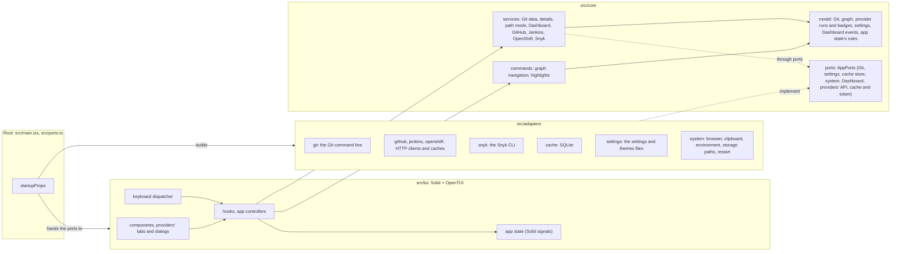

# Architecture

codepulse is a terminal app in Solid and OpenTUI on Bun, built as ports and adapters. Its logic lives in `src/core`,
plain TypeScript that knows nothing of Solid, the terminal, Bun or the outside world. Everything it needs from outside
comes in through ports: interfaces core declares. `src/adapters` implements them, `src/tui` is the terminal front end
on top of core, and the root (`src/main.tsx`, `src/ports.ts`) builds the adapters and hands them to the front end.



## Layers

| Folder | What | May import |
|--------|------|------------|
| `src/core` | the app's logic and its ports: no Solid, OpenTUI, `node:*` or `bun:*` | core |
| `src/adapters` | what implements the ports | core, adapters |
| `src/tui` | the terminal front end | core, tui |
| root: `src/*.ts`, `src/cli` | builds the adapters, starts the front end | everything |

`src/layers.test.ts` resolves every import and fails on one that crosses into a layer its folder may not use. Biome
refuses the same by folder name as the import is written, and refuses Solid, OpenTUI and the runtime in core.

```
src/
  core/        model, services, commands, ports
    git/  github/  jenkins/  openshift/  snyk/  dashboard/  settings/
  adapters/    git/  github/  jenkins/  openshift/  snyk/  cache/  settings/  system/  dashboard/  http.ts
  tui/         app/  components/  context/  dashboard/  debug/  graph/  hooks/  keyboard/  providers/  utils/
  cli/         arguments and help
  index.tsx    the entry: loads main.tsx
  main.tsx     startupProps: the ports, the settings, which screen to open
  ports.ts     the terminal app's adapters, in one place
  providers.ts the providers the app runs with: the one list of them
tests/         tests across the layers, and their helpers (the fetch lifecycle contract)
```

## Ports

`AppPorts` (`core/app-ports.ts`) is every port the app runs on. `src/ports.ts` builds the terminal app's, `startupProps`
hands them to the app and registers them (`tui/context/ports.ts`) for a component rendered without them, as in a
test. A hook called while its component sets up takes a port as a parameter; a component below the root reads it from
its context (see the Solid rules in AGENTS.md). The adapters' port objects call their modules' functions when they run,
so a test's `spyOn` on such a function sees the app's calls.

| Port | Declared in | Implemented in | The UI reaches it through |
|------|-------------|----------------|---------------------------|
| `GitPort` | `core/git/port.ts` | `adapters/git/git-cli.ts` | hook parameters, `useGit()` |
| `SettingsPort` | `core/settings/port.ts` | `adapters/settings/settings-file.ts` | hook parameters, `useSettings()` |
| `CacheStorePort` | `core/cache-store.ts` | `adapters/cache/cache-store.ts` | hook parameters, `useCacheStore()` |
| `SystemPort` | `core/system.ts` | `adapters/system/system-port.ts` | hook parameters, `useSystem()` |
| `DashboardReader` | `core/dashboard/load.ts` | `src/ports.ts` over `adapters/dashboard/load.ts` | the Dashboard controller |
| the providers: their definitions and adapters (`ProviderSet`) | `core/provider-set.ts` | `src/providers.ts` | `state.providers.set`, `useProviderSet()` |
| a provider's adapters (API, cache, token) | `core/<provider>/service.ts` | `adapters/<provider>/adapters.ts` | the provider's module |
| the app's state, for a provider | `core/provider-ports.ts` | `tui/providers/shared/app-port.ts` | the provider's hook |

## Services

Each service is a plain function or class in core with its ports as parameters, tested without Solid; a hook in
`src/tui` adapts it: it runs the effects, makes the service's reads reactive and stops it on cleanup.

| Service | Core | Hook |
|---------|------|------|
| the graph's Git data: load, pages, fetch | `core/git/data-service.ts` | `tui/hooks/use-data-loader.ts` |
| the selected commit's details | `core/git/commit-detail.ts` | `tui/hooks/use-detail-loader.ts` |
| path mode | `core/git/path-filter.ts` | `tui/hooks/use-path-filter.ts` |
| the Dashboard's events | `core/dashboard/load.ts` | `tui/dashboard/use-dashboard.ts` |
| a provider's fetch lifecycle (when, how often, backoff) | `core/fetch-lifecycle.ts` | `tui/providers/shared/use-provider-fetch-lifecycle.ts` |
| GitHub, Jenkins, OpenShift, Snyk | `core/<provider>/service.ts` | `tui/providers/<provider>/use-*.ts` |
| which rows a long list mounts | `core/scroll-window.ts` | `tui/hooks/use-scroll-window.ts` |

## Providers

A provider is its own files, one folder per layer, joined by its id:

| Layer | Folder | What it holds |
|-------|--------|---------------|
| core | `core/<provider>/` | `definition.ts`: its id, settings key, names and tabs, its settings (defaults, how the file's section is read and checked, what a backfill writes) and the Dashboard events it stored; `events.ts`, `banner.ts` (its messages), its service and model |
| adapters | `adapters/<provider>/` | `adapters.ts`: its API, cache (named by its id) and token |
| terminal | `tui/providers/<provider>/` | `module.ts`: `start` (the provider itself, with its settings and adapters), its colors, Menu rows (`menu-items.ts`), detail tabs, graph columns, legend (`legend.ts`) and what it does on its own (a background error, a tab notice, a dialog) |

`src/providers.ts` lists them once: each provider's module (which carries its definition) and its adapters' factory,
which the compiler checks fit together. The ports build a provider set from the list (`AppPorts.providers`: the
definitions, in order, and each one's adapters, handed back only for the definition they were built for), and startup
registers the modules. The set refuses a provider whose id, settings key or tabs collide with another's or the app's
own (`git`, `dashboard`, Git's tabs), and the host (`modulesFor` in `tui/providers/module.ts`) one without exactly one
module for its own definition.

Everything else reads them: the settings model reads, writes and backfills each section through its definition (a
field given as undefined is cleared); the views, their order and names come from the set; the provider host
(`tui/app/providers.ts`) starts the modules and is the rest of the app's one way to them (refresh, start over, the
events they hold, their detail tabs, graph columns and messages); the Menu, the graph, the detail view, the Dashboard
and `:hide`/`:show` ask the modules. Outside a provider's folders only the built-in themes name the built-in providers:
their colors are theme keys (`tui/context/theme.ts`). A new provider picks its colors from the theme, and each one a
theme lacks falls back to the accent, so a custom theme made before it still works.

A provider needs only what it uses: a graph column, a background error or a dialog of its own is optional, and a
provider without columns shows a CI provider's counts and last run. `src/providers.test.tsx` adds one written only in
the test, through `startupProps` and through the app, and checks the view cycle, the command bar, its detail tab with
its own settings, `:reload`, the Dashboard and `:hide`/`:show`, the cache screen (its data counted, evicting it starts
it over), its writes reaching the app's cache registry and not the process's, its Menu section turning it off (also
while its view is open) and saving that, its settings read back through its own rules, and the app stopping it.

## Runtime dependencies

The layers test checks imports. What the code reaches while it runs, without an import:

- **Registered defaults.** A component without a context reads the ports and modules the root registered
  (`tui/context/ports.ts`, `tui/context/provider-modules.ts`), for a component rendered on its own in a test. The app
  provides its own; `src/providers.test.tsx` checks a whole app never reads the registered ones.
- **Process-wide objects.** The debug log (below), the cache registry's default, and small caches (dates, colors).
- **The runtime.** Core uses the clock and timers every JavaScript runtime has: the fetch lifecycle and the commit
  details take timers as a port, Snyk's scan queue and `core/abort.ts` use the global ones. The terminal front end
  uses Bun only for text width (`tui/utils/terminal-text.ts`).
- **Strings that must agree.** A provider's id names its cache rows and its events' source; its settings key is its
  section in the settings file and its `:hide` name. Each comes from its definition.
- **Shared files.** The providers share one SQLite cache and one settings file; Git runs as a process on `PATH`.
- **Screens that close.** OpenTUI refuses an element used by another renderer than the one that drew it: a timer or
  retry that touches the screen is cancelled when its screen closes (`useScrollSchedule` in `tui/utils/scroll.ts`).

## State and commands

The app's state is Solid signals in `tui/context/state.ts`: the repository, the graph, the cursor, the providers'
status and badges, and one detail slot each for the graph and the Dashboard. Its shape and rules are a port in core
(`core/app-state.ts`): which highlight wins, which commits a search matches, how far a cursor moves. What the app does
is core commands over that port: moving through the graph (`core/navigation.ts`) and turning highlights on and off
(`core/highlights.ts`). Core knows no terminal words: no characters, colors or column widths. It lays the graph out in
lanes and connectors (`core/git`) and sorts a status into passed, failed or running (`core/status.ts`); the terminal
draws them as box-drawing characters and ✓ ✗ ● (`tui/graph`, `tui/utils/status-icon.ts`) and sizes the columns. Focus, dialogs, the command bar and its `:` commands
(`tui/app/app-commands.ts`), and which step Esc takes back (`tui/keyboard/cascade.ts`) are the terminal's: its keys and
commands call the core commands and the services.

The app's root (`tui/app/app-content.tsx`) builds the state and the controllers and provides the contexts;
`tui/app/layout.tsx` draws the screens from them.

## Process-wide objects

The cache registry (`ProviderCacheRegistry`, `adapters/cache/sha-sqlite-cache.ts`) holds the open cache databases, one
per folder, and what belongs to each: the writes an eviction drops, the cache screen's pause, the listeners told about
a write. `terminalPorts({ cacheRoot, registry })` builds the providers' caches, the cache screen and the Dashboard on
one folder and one registry; the terminal app uses the process's (`providerCacheRegistry`). `src/ports.test.ts` checks
that ports built on a registry of their own write, evict and read through it alone.

The debug log (`debugLog`, `core/debug-events.ts`) is the process's: the adapters and services write to it directly,
so two apps in one process share it.
