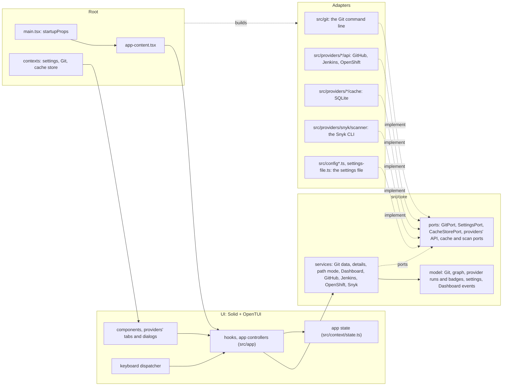

# Architecture

codepulse is a terminal app in Solid and OpenTUI on Bun. Its logic lives in `src/core`, plain TypeScript that knows
nothing of Solid, the terminal, Bun or the outside world. Everything it needs from outside comes in through ports:
interfaces core declares and the app implements. Solid hooks adapt core to the UI, and the root wires the ports to
their implementations.

## Layers

| Layer | Where | What it may use |
|-------|-------|-----------------|
| Core | `src/core` | only `src/core` and plain packages; no Solid, OpenTUI, Bun or Node runtime APIs |
| Adapters | `src/git`, `src/providers/*/{api,cache,scanner}`, `src/providers/shared/{http,sha-sqlite-cache,cache-management,cache-store}`, `src/config.ts`, `src/config-write.ts`, `src/settings-file.ts`, `src/dashboard/load.ts` | core, Bun and Node |
| UI | `src/components`, `src/hooks`, `src/app`, `src/keyboard`, `src/utils`, `src/dashboard`, the providers' hooks and tabs | core, Solid, OpenTUI; adapters only through ports |
| Root | `src/main.tsx`, `src/app-content.tsx`, the contexts' defaults in `src/context` | everything: it builds the adapters and hands them on |

Three checks keep the layers apart:

- `src/core/boundary.test.ts` resolves every import of a core module and fails on one that leaves `src/core`.
- Biome refuses Solid, OpenTUI, `bun:*`, `node:fs` and `child_process` in core, and the app's layers by name.
- Biome refuses the adapters in the UI layers: they reach Git, the network, the caches and the settings file through
  the ports.

## Ports

| Port | Declared in | Implemented by | Reaches the UI through |
|------|-------------|----------------|------------------------|
| `GitPort` | `core/git/port.ts` | `src/git/git-cli.ts` | `startupProps`, hook parameters, `useGit()` |
| `SettingsPort` | `core/settings/port.ts` | `src/settings-file.ts` | `startupProps`, hook parameters, `useSettings()` |
| `CacheStorePort` | `core/cache-store.ts` | `src/providers/shared/cache-store.ts` | `app-content`, hook parameters, `useCacheStore()` |
| a provider's API, cache and token | `core/<provider>/service.ts` | `src/providers/<provider>/api.ts`, `cache.ts` | the provider's hook |
| Snyk's scan and cache | `core/snyk/service.ts` | `src/providers/snyk/scanner.ts` | `use-snyk` |
| the Dashboard's sources | `core/dashboard/load.ts` | `src/dashboard/load.ts` (the provider caches) | `app-content` |
| the app's state, for a provider | `core/provider-ports.ts` | `src/providers/shared/app-port.ts` | the provider's hook |

A hook called while its component sets up takes a port as a parameter; a component below the root reads it from its
context (see the Solid rules in AGENTS.md). The adapters' port objects call their modules' functions when they run, so
a test's `spyOn` on such a function sees the app's calls.

## Services

Each service is a plain function or class in core with its ports as parameters, tested without Solid; a hook in the UI
adapts it: it runs the effects, makes the service's reads reactive and stops it on cleanup.

| Service | Core | Adapter hook |
|---------|------|--------------|
| the graph's Git data: load, pages, fetch | `core/git/data-service.ts` | `hooks/use-data-loader.ts` |
| the selected commit's details | `core/git/commit-detail.ts` | `hooks/use-detail-loader.ts` |
| path mode | `core/git/path-filter.ts` | `hooks/use-path-filter.ts` |
| the Dashboard's events | `core/dashboard/load.ts` | `dashboard/use-dashboard.ts` |
| a provider's fetch lifecycle (when, how often, backoff) | `core/fetch-lifecycle.ts` | `providers/shared/use-provider-fetch-lifecycle.ts` |
| GitHub, Jenkins, OpenShift, Snyk | `core/<provider>/service.ts` | `providers/<provider>/use-*.ts` |
| which rows a long list mounts | `core/scroll-window.ts` | `hooks/use-scroll-window.ts` |

## State

The app's state is Solid signals in `src/context/state.ts`: the repository, the graph, the cursor, the providers'
status and badges, and one detail slot each for the graph and the Dashboard. The services read and change it through
narrow ports that the state fits. The key handlers (`src/hooks/handle-*-keys.ts`, `use-keyboard-navigation.ts`) and
the `:` commands (`src/app-commands.ts`) change it directly.

Process-wide objects a host could give each app its own of: the cache registry (`ProviderCacheRegistry`, one database
connection per cache folder) and the debug log (`DebugLog`).
